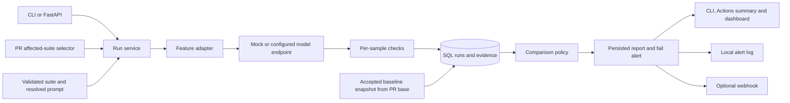

# RegressGuard implementation handoff

**Planning date:** November 8, 2026. **Owner for implementation:** GPT-6.1 Sol. **Status:** design and acceptance contract for a fresh Python 3.12 repository.

## The decision this tool supports

A reviewer is deciding whether to merge a prompt or model change. They need to know what behavior was promised, which examples lost it, whether a critical example ever failed, and what changed since the accepted run. The primary deliverable is that decision in the PR job summary. The CLI, API, and dashboard should all show the same persisted report.

Build a local-first pre-merge evaluator for single-turn text and JSON features. Both samples are fictional. Put “Independent portfolio project. All demo inputs and outputs are fictional/sample data” in the README, demo suites, demo reports and dashboard. Real provider runs on user-supplied suites must retain their actual provenance. Show recorded results only. A fresh install may legitimately have an empty history.

### Why this scope fits November 2026

Repeated evaluations and per-example comparison are established practices. LangSmith documents running multiple trials, and Promptfoo documents evaluations in GitHub Actions. The reason to build this project is narrower: a reviewer can reproduce a blocked decision offline, identify the exact accepted evidence, and see a once-in-three critical failure even when the mean looks healthy. Three trials provide a useful smoke test. They cannot establish a population failure rate or statistical significance. [LangSmith repetitions](https://docs.langchain.com/langsmith/repetition) · [Promptfoo GitHub Actions integration](https://www.promptfoo.dev/docs/integrations/github-action/)

## Reference architecture



Use one synchronous application service with bounded repetitions and request timeouts. CLI, CI, and FastAPI call it directly. SQLite is the default. One service process is enough for the demo. Do model I/O outside write transactions. Use portable SQLAlchemy 2 models, UTC timestamps, explicit transactions, and an integration check against PostgreSQL. A prompt file, a version, an approved run, and a baseline pointer are four distinct things.

| Location | Responsibility |
| --- | --- |
| `regressguard/suites.py`, `checks.py` | Strict YAML schema, safe prompt resolution and rendering, pure validators with typed evidence |
| `regressguard/providers.py`, `demo/mock.py` | Generation and judge boundaries, independent mock implementations for the two features |
| `regressguard/runner.py`, `comparison.py` | Sample collection, coverage accounting, pure comparison policy |
| `regressguard/storage.py`, `alerts.py`, `reporting.py` | Run and baseline transactions, alert delivery, common report renderers |
| `regressguard/cli.py`, `regressguard/ci.py` | Installed CLI, affect analysis, summary and exit status |
| `api/`, `prompts/`, `suites/`, `baselines/`, `demo/` | Server-rendered UI, versioned user inputs, portable accepted evidence, break script |
| `tests/`, `.github/workflows/` | Offline contract tests, PR gate, implementation checks |

Use stdlib argparse, hashlib, difflib and JSON where practical. The requested stack authorizes FastAPI, Pydantic v2, SQLAlchemy, pytest and Ruff. Use Jinja2, Uvicorn, a safe YAML parser, a Draft 2020-12 JSON Schema validator, and a PostgreSQL driver for the specified capabilities. Use stdlib HTTP or an already required suitable HTTP client behind a thin adapter. Keep sentence-transformers an optional extra. Resolve and pin compatible versions and transitives on Python 3.12 at implementation time, commit the lock, and use it for dev, CI and Docker. Review additions beyond these scoped dependencies with the owner.

## Suite and provider contracts

Use a versioned YAML schema. Give each suite and case a stable ID independent of the filename. Reject duplicate keys and IDs, unknown check types, out-of-range thresholds, non-finite numbers, empty cases/checks, and unresolved placeholders before starting a run. Restrict prompt references to regular files under the configured prompts directory, including after resolving symlinks. Use a literal `{{input}}` placeholder and single-pass substitution. Treat ticket text, braces and quotes as data. Keep the untrusted feature input in a user message where the adapter supports separate roles. Hash the exact resolved template bytes, and store the text needed for later diffs.

**Fictional sample suite excerpt** showing one case. The full classifier suite should ship with roughly twenty.

```yaml
schema_version: 1
id: ticket-classifier
name: Support ticket classifier
data_label: fictional_sample
feature:
  prompt: prompts/classifier/v1.txt
  prompt_version: v1
  model: mock/ticket-classifier-v1
  generation: {temperature: 0, max_tokens: 120}
policy: {aggregate_drop_points: 5}
cases:
  - id: shared-outage
    input: "Nobody on our team can sign in after this morning's update."
    expected_behavior: "Escalate a team-wide service outage as urgent."
    severity: critical
    checks:
      - type: json_schema
        schema:
          type: object
          required: [category, priority]
          additionalProperties: false
          properties:
            category: {const: technical}
            priority: {const: urgent}
```

Define a small provider protocol: a resolved target, rendered messages, explicit generation params, repetition index and timeout go in. Text, requested and returned model IDs, finish reason when available, usage and usage source come out. A feature adapter must never receive expected behavior, reference output, test ID, checks or severity. A user can add a prompt suite without writing Python. An application with custom preprocessing or an internal LLM-powered feature can implement this same boundary to evaluate its actual response path. Document this extension seam.

Default explicitly to mock even if a developer has a key in their shell. Real generation requires explicit provider selection and an environment key. Support the documented subset of the OpenAI-compatible chat-completions protocol; test request, response, timeouts, auth errors, malformed responses, absent usage and returned model IDs with a fake transport. Unsupported params or transport errors are visible. Never silently switch a requested live run to mock. Judge selection and keys are independent of generation. Give every call a deadline and bound total calls by suite size, repetitions and checks. No automatic resampling of poor answers. Record latency with a monotonic clock on every attempted generation. Record `tokens_used` and `usage_source` per sample; count mock tokens with a documented deterministic rule, use reported usage for live calls and null with a reason if unavailable. Keep judge usage separate.

| Check | Required behavior |
| --- | --- |
| `exact_match` | Strict string equality, including whitespace. Any normalization must be explicit and part of the check fingerprint. |
| `contains` | One substring or nonempty keyword list. Specify all/any, default all, case-sensitive by default. |
| `regex` | Compile at suite validation and use search semantics. Bound output size and execution time for untrusted patterns, including in CI. |
| `json_schema` | Parse the entire raw answer as strict JSON, then validate. Preamble, fenced JSON, duplicate object keys and non-finite literals fail. Invalid schemas are suite errors. Allow local references only. Assert correct field values as well as output shape for classification. |
| `semantic_similarity` | Record cosine score, reference and threshold; equality passes. Resolve the backend once per run. Auto mode uses a locally available, revision-pinned sentence-transformers model if installed and cached, otherwise deterministic TF-IDF cosine. Pin TF-IDF in default CI. Define lowercase Unicode word tokens, smoothed IDF fit on fixed suite reference texts, L2 normalization and zero-vector score 0. Fingerprint the reference corpus and algorithm. Explicit embedding mode with missing assets gives an actionable error. |
| `llm_judge` | Explicit judge model and versioned rubric, bounded structured output with finite score in [0,1], short rationale, threshold inclusive. Treat candidate text as quoted evidence. Missing key or explicitly disabled judge produces `skipped` with reason. Timeout, invalid JSON or out-of-range score produces `error`. Test with a stub for pass, fail and error, and without credentials for skip. |

Use closed-schema validation with `required` and `additionalProperties` chosen deliberately. Configure embeddings for local-only loading with remote code disabled. Record backend, revision or local artifact digest and evaluator version. Identical thresholds on different representations have different meanings. [JSON Schema object reference](https://json-schema.org/understanding-json-schema/reference/object) · [SentenceTransformer constructor](https://www.sbert.net/docs/package_reference/sentence_transformer/model.html)

## Scoring and release policy

1. Execute exactly N feature generations per case for a completed run. Default N=3. Store each check outcome as `pass`, `fail`, `skipped` or `error`, with a reason and raw numeric score where relevant. A sample passes when at least one check executed and all executed checks passed. A skipped judge alongside a deterministic check shows up in coverage. A case with only skipped checks cannot contribute positive evidence.
2. Case pass rate is passed samples / N. Aggregate score is 100 times the arithmetic mean of case rates. Keep counts and compare unrounded rational values. All cases carry equal weight. Severity adds a hard gate. Persist skips, errors and denominators, including the baseline's. Use the same active check set when comparing; a newly enabled judge or changed semantic backend needs a new compatible reference.
3. A comparable, complete run **fails** if any critical case has even one failed sample, or if baseline aggregate minus candidate aggregate is strictly greater than the suite threshold. Equality at the threshold is nonblocking. A critical case that already failed in an explicitly referenced run still fails today. Record every negative case delta even if another case improved.
4. **Warn**, exit 0, when there is a negative case or aggregate delta below or at the boundary, partial check coverage, or a standard-case failure on an unbaselined run. Otherwise **pass**, exit 0. A quality **fail** exits 1 and creates an alert. Default N is small: display `2/3 → 1/3` alongside percentages and mark mixed outcomes. Use “observed change” language; prompt/model/parameter diffs establish association only.
5. Bad config, an explicitly requested missing baseline, incompatible evidence, provider/evaluator errors or an entirely unscored case make the comparison incomplete. Exit 2 and block CI. Store diagnostics and any partial observations; no green verdict or quality alert for an incomplete run. If both an error and a critical failure occurred, highlight the observed critical failure in the incomplete report. Treat a model returning bad JSON to a JSON case as a quality failure; distinguish a malformed provider envelope as an execution error.
6. Running without `--baseline` explicitly collects a reference; label the report “uncompared” with no aggregate delta and still apply the critical gate. `--baseline latest` means the last *promoted run for this suite*, never the newest run on disk. Explicit IDs must match the suite. Freeze baseline ID when the run starts.

**Arithmetic acceptance fixture (synthetic, not measured):** with 20 equally weighted cases, one case moving from 3/3 to 0/3 drops the mean by exactly 5 points. If standard, that is a warning at the default threshold. If critical, it fails. One critical sample dropping from 3/3 to 2/3 also fails despite an aggregate loss of only 1⅔ points. A second standard-case loss beyond the five-point boundary fails on aggregate alone.

## Persistence, comparison identity and promotion

Keep immutable run evidence. Store a run header, per-case/per-attempt results and checks (nested JSON is fine), one promoted pointer per suite, and one alert row per failed run. Use stable UUID run IDs and uniqueness on `(run, case, attempt)` and `alert.run_id`. Store start/end times, nullable Git SHA plus dirty flag when knowable, suite/engine schema versions, provider and resolved target configuration, prompt version/content/hash, scoring contract, repetitions, case counts, measurements, baseline ID and report. A dirty tree's SHA alone cannot reconstruct its prompt. Bound saved text and label any truncation; perform checks on the complete supported response. Escape model text in HTML and Markdown reports.

Persist a running header before execution; finalize results, report and alert intent transactionally. An interrupted run stays visibly incomplete and ineligible for promotion. No automatic restart or background worker is necessary for v1. Use database transactions for pointer updates and always compare against the initially resolved ID. Promotion of the same ID is idempotent. Require a completed run with measurable coverage, no failed critical case, and no fail verdict. Show any warnings at explicit promotion.

**Comparison identity.** The target fingerprint contains prompt bytes, model/provider and params and is expected to change. The evaluation contract fingerprint covers suite ID, case IDs/inputs/severity/expectations/checks, rubric, active check set, evaluator algorithm or model revision, repetition count and scoring policy. Use stable canonical JSON, sort cases by ID and SHA-256 the result. A changed evaluator contract is a new measuring instrument. Report exactly which components changed. Do not compute an aggregate delta between unlike contracts. Keep model identity explicit so mock-to-live or live-model comparisons, when intentionally requested on a compatible contract, are labeled as such.

**Baseline portability.** Local SQL supports history and `regressguard baseline --run ID`. Ephemeral CI imports a portable, versioned JSON snapshot from `baselines/<suite-id>.json` on the PR base commit. Provide `regressguard baseline --run ID --export PATH` to write the promoted snapshot. Include run ID, suite/contract fingerprint, case counts and rates, prompt text/model/params, evaluator provenance and repetitions; omit raw user outputs and credentials. Validate schema, IDs, counts, recomputed aggregates and hashes on import. The reviewed Git commit anchors trust; a self-declared hash alone does not. Generate and commit real snapshots for both fictional demos. Never hand-author outcomes or commit a runtime database.

## CI workflow and suite evolution

Use `pull_request`, a stable job name such as `RegressGuard gate`, read-only contents permissions, SHA-pinned actions, credential-free checkout after fetching, and the mock adapter. Use `GITHUB_STEP_SUMMARY` for the report so fork PRs work without a write token or webhook secret. Trigger on every PR and select affected suites inside the job. This also gives docs-only PRs a successful required check. Workflow-level path filters can leave checks pending and have changed-file limits. [GitHub workflow syntax](https://docs.github.com/en/actions/reference/workflows-and-actions/workflow-syntax) · [Secure use of Actions](https://docs.github.com/en/actions/reference/security/secure-use) · [Job summaries](https://docs.github.com/en/actions/reference/workflows-and-actions/workflow-commands#adding-a-job-summary)

1. Fetch enough history to resolve the event base, PR head and tested merge SHA. Use base tree for accepted snapshots and suite contracts; test the merge tree to capture the proposed result against current base. Record all three SHAs. Diff the base tree against that exact tested tree, including both names for renames. Pass filenames as data, never as shell code. A missing ref or failed selector blocks the job.
2. Build the dependency map from both trees. Changed suite or baseline files select their suite; changed prompt selects every referencing suite. Changes to mock, engine, dependency lock or workflow select all. Fail on duplicate IDs, dangling paths or unmappable changes within evaluation roots. Report successful “no affected suites” only after a valid diff. Deleted suites must be explicitly reported and blocked pending a reviewed retirement policy; a rename retaining the stable suite ID works.
3. For each existing suite, import the **base** snapshot into a fresh temporary SQLite DB. Execute the **candidate target** (its prompt, model, params and template binding) on the **accepted base cases, checks and policy**. A PR that edits answers, relaxes the threshold, removes a critical test or replaces its baseline must still pass this lane. For runner/workflow changes, reviewers must inspect the enforcement code itself; branch protection and code-owner review for these files are repository settings to document.
4. If the proposed suite contract also changed, run it separately on the candidate target and list added/removed/changed cases and policy in the summary. Require a reviewed replacement snapshot with matching new contract, generated by explicit promotion; for shipped deterministic suites verify proposed snapshot counts by replay. Require passing criticals, successful execution and publish standard failures for review. Only the next PR can read that merged snapshot as accepted evidence. An existing suite missing a base snapshot is a blocking setup error. A genuinely new suite uses a clearly labeled bootstrap run plus a replay-validated proposed snapshot. It has no historical delta. Validate baseline-only changes by replaying the proposed reference configuration and confirming promotion eligibility. A prompt-only change can keep its earlier baseline.
5. Run all selected suites and publish a bounded per-suite Markdown summary and machine-readable JSON even if one fails. Return 2 for any incomplete comparison, otherwise 1 for any fail, otherwise 0. Preserve this status through summary/artifact steps. Use one local CI command with explicit refs so pytest can invoke the same path as Actions. README identifies the job name maintainers can require before merge.

If evaluator code changes the scoring algorithm, bump its evaluator version. In that PR, replay the accepted checks with the base revision of the evaluator on the candidate outputs, then score with the proposed evaluator separately and review the new snapshot. For gate development, use an integration fixture with deliberately changed scoring to prove these reports stay distinct.

Keep PR CI offline after dependencies install. Make the public demo baseline a versioned **mock** contract with pinned deterministic evaluator settings. Opt-in live evidence belongs in local SQL or a separately configured trusted run; a hosted model alias can change between requests. A real provider gate requires an accepted live reference, an explicit budget and protected credentials.

## API, report and alert contract

| Route | Behavior |
| --- | --- |
| `GET /api/suites` | Discover valid suites, feature, count, severity and promoted baseline |
| `POST /api/runs` | Accept suite ID, optional baseline selector and bounded repetitions; execute and return persisted report and run ID |
| `GET /api/runs?suite=…` | Paginated, newest-first history with explicit status, score and version |
| `GET /api/runs/{id}/report` | Same schema used for CLI JSON, summary and HTML |
| `POST /api/runs/{id}/baseline` | Promote under the same service rules as CLI |
| `GET /api/alerts` | Paginated logical alerts and delivery status |
| `GET /`, `GET /runs/{id}`, `GET /healthz` | Dashboard, shareable local report page, process/database readiness |

Use 404 for missing resources, 422 for bad input and 409 for a promotion or baseline conflict. A completed quality failure is a successful API operation with a fail report; return an explicit error status and run ID for execution failures. Accept only registered suite IDs at the API boundary. Bind the published Compose port to loopback by default. Keep mutation requests JSON-only with no permissive cross-origin settings. A synchronous server endpoint with a documented limit on concurrent work is sufficient for v1.

**Runtime configuration.** Document these names and safe defaults in `.env.example`. `DATABASE_URL` selects SQLite or PostgreSQL, `REGRESSGUARD_DATA_DIR` owns local artifacts, and `REGRESSGUARD_PROVIDER` defaults to `mock`. Reserve `OPENAI_BASE_URL` and `OPENAI_API_KEY` for opt-in live generation, `REGRESSGUARD_JUDGE_MODEL` and a separate judge key for opt-in judging, `REGRESSGUARD_SEMANTIC_BACKEND` and an optional local model path for similarity, and `REGRESSGUARD_WEBHOOK_URL` for alerts. Leave secret values blank. Exclude real environment files, databases, logs and tool-local state from Git and image build context. Document `postgresql+psycopg://` and normalize conventional `postgresql://` URLs to the installed driver. Example config must start the demo without edits.

**Reviewer experience.** Let a reviewer select a suite, trigger a run and follow its report from the dashboard. Lead with verdict, reason, baseline and candidate IDs, fractional scores, critical failures and exact change in points. Then show all negative deltas, representative failing attempt, expected vs actual, failed check and reason. Include unified prompt diff, model/params diff, check coverage and evidence provenance. A missing Git commit is legitimate. The dashboard needs a per-suite trend with baseline markers and a table alternative, latest report and version timeline linked to runs. Break trend lines when evaluation contracts change. Provide empty, incomplete and no-baseline states. No frontend build, external chart CDN or synthetic historical traffic.

**Alert delivery.** For each completed fail, persist exactly one logical Slack-compatible payload with stable run ID, suite, old/new versions, failing case IDs, before/after counts (or unavailable), verdict reason and a bounded summary. Append the same payload as one JSON object per line under the data directory; send that stored payload to the environment-configured webhook if present. Make repeated finalization idempotent. Persist local and remote delivery status separately, apply a bounded timeout and expose delivery errors in the report. File or webhook failure cannot turn a quality fail green. A file and HTTP POST are outside the SQL transaction: acknowledge possible duplicate physical delivery after a crash, use the run ID for deduplication, and keep the SQL payload available for recovery. No webhook URL, bearer token or raw customer input in alerts. [Slack incoming webhook format](https://docs.slack.dev/messaging/sending-messages-using-incoming-webhooks/)

## Demo design and operator flow

- **Classifier:** ship roughly 20 labeled fictional cases spanning billing, account, technical and general requests. Define the category/priority rubric in the suite docs. Include angry sentiment without outage, vague requests, non-English text, conflicting signals, explicit “not urgent”, team-wide outages, quoted instructions and confusing brace/JSON text. Mark explicit business-critical cases. Use JSON Schema with per-case values so syntactically valid wrong labels fail.
- **Summarizer:** ship a small separate suite with short fictional inputs. Check salient facts, numbers or negations where possible; add semantic references and an optional rubric judge alongside offline assertions. Exercise every check type across the suites and tests. Explain what the lexical fallback can miss, especially negation and paraphrase.
- **Mock:** explicit feature behavior using input and requested prompt instructions. Simulate variation via a stable digest over input, target and attempt index; avoid Python's randomized hash. Never consult the answer key. Test identical runs across processes and test that the broken prompt changes actual returned text. This fixture demonstrates the pipeline's mechanics, not a general-purpose classifier or an estimate of model quality.

README walkthrough to implement and actually execute:

1. Install from the pinned lock, optionally copy `.env.example`, run `regressguard run --suite suites/ticket-classifier.yml --runs 3`, then `regressguard baseline --run <printed-id>`. Keep that ID in the transcript. A clean run with `--baseline latest` should exit 0.
2. Run `python demo/break_it.py`. Require the script to use a working copy of the prompt/suite, preserve user edits and use the same DB/baseline. Remove the JSON-format instruction, bump prompt version, retain inputs/checks and call the normal runner with `--baseline latest`. Propagate exit 1. Print the failing run ID, critical case, prompt diff and location of the actual JSONL alert. Keep the failed run visible in history. An absent baseline must produce actionable exit 2.
3. Run the original suite against the same baseline and observe exit 0. For a hosted demonstration, make the equivalent edit on a branch and open a PR. The required job must fail and its summary must show the same regression. Fix the prompt in that PR and show the job turns green. Record actual links only if a remote exists and publication is authorized.
4. `docker compose up --build` starts the API and dashboard with both suites discoverable, persisted SQLite and local alerts on a named volume. On a fresh demo volume, import the shipped demo snapshots idempotently so a user can run against a baseline immediately. Restarts must preserve later promotions. Document a PostgreSQL URL (including driver selection) using placeholders, and how CLI and Compose can target the same data store.

## Implementation order and verification gates

| Milestone | Deliverable | Evidence before moving on |
| --- | --- | --- |
| 1. Vertical slice | Packaging, strict suite loader, one classifier case, offline provider, schema check, SQL storage, run/promote/compare CLI | Fresh DB → measured baseline → changed prompt → quality exit 1 → persistent report. Restore prompt → exit 0. |
| 2. Evaluation engine | All checks, repeats, second feature, exact policy, coverage and provenance | Unit matrix below; frozen mock results consistent across processes; no model downloads. |
| 3. Durable CI evidence | Snapshot import/export, real demo snapshots, changed-file selection, base-contract and candidate-contract execution | Local temp Git repo exercises the actual gate command for clean and failing merges, baseline substitution and case removal. |
| 4. Delivery surfaces | Alert log/webhook, API, Jinja dashboard, Docker, PostgreSQL support | Fake webhook captures exact stored payload; failure injection stays red. API parity tests; inspect rendered dashboard and run page; run Compose health and persistence smoke. |
| 5. Handoff proof | Complete docs, break script, Actions workflow, locked installs | Fresh checkout proof, genuine green/red/green CI evidence when a GitHub repo is available. State separately which tests were offline, which used local services, and whether a hosted run was observed. |

**Required test matrix**

- Parametrize pass/fail for all six checks, threshold equality, strict malformed JSON vs valid-but-wrong labels, optional judge skip and bad judge response, cached-backend selection and offline TF-IDF. Assert no network from default pytest after installation; live transport is stubbed. Include a no-key run with the judge visibly skipped.
- Test exact-boundary and just-over-boundary aggregate drops, critical 2/3, mixed standard samples, improvements masking a single regression, no regression, all-skipped, missing usage and infrastructure error. Check report denominators and exit 0/1/2 using the installed command, including a DB reopened by a second process.
- Test promote/retrieve/re-promote, stable comparator during concurrent promotion, cross-suite/wrong/missing reference, changed case or evaluator, snapshot round-trip, tamper/corruption and interrupted run. Check PostgreSQL in a distinct CI integration job with a service container; default pytest uses temporary SQLite and needs no external services.
- Test selector on unrelated files, shared prompts, renamed/deleted paths, engine and baseline edits, new suite bootstrap and unreadable Git refs. A PR that both breaks the prompt and edits expected answers or the baseline must still fail. Assert multiple suites all report, the workflow exposes the underlying exit status, and CI never depends on cached DBs or secrets.
- Test local-only alert, webhook parity, delivery failure, repeated finalization and lookup via API. Verify escaped HTML/summary text and no secret serialization. Test Compose from an empty volume, compare after startup, restart, and confirm run/baseline persistence. Include README instructions for adding a suite, exporting a baseline, and updating it deliberately.

**Release evidence checklist:** Python 3.12 clean locked install, `ruff check .`, `pytest`, local fixture gate exit codes, CLI demo’s observed run IDs, composed API health/dashboard/report, PostgreSQL smoke and Actions job summary. Use real output from these checks when publishing. If Docker, a remote PR, or a live credential is unavailable, name the unverified integration. The offline suite must still pass.

## Boundaries to document

The reference corpus is fictional and small. A pass says the feature met these checks on these attempts. The mock is scripted, repeated trials may be correlated, and the TF-IDF fallback measures lexical overlap. Live judge output can be biased or influenced by candidate text. Latency and usage are diagnostic measurements; the default gate acts on quality only. Local-only alert delivery is the default. The local dashboard stores potentially sensitive evaluation evidence; document retention and access before use with private data. The demo is single-process, with no multi-tenant auth, continuous traffic monitoring or guaranteed external delivery. SMTP, distributed scheduling and statistical release policies are outside the initial delivery.

## Paste into the 6.1 Sol implementation session

> Build RegressGuard end to end in this workspace using IMPLEMENTATION_PLAN.md as the implementation and acceptance contract and the original brief as the product requirements. Follow the repository instructions. Start with the CLI vertical slice and prove it can block a broken candidate against a stored baseline. Then complete both suites, offline checks, real CI workflow, API, dashboard, alerting, Docker, tests and README. Preserve the documented score math, comparison identity and base-commit baseline rules across every entry point. Generate all sample evidence by running the tool. Verify using the commands and scenarios in the handoff, finish all locally achievable work, and report exactly which integrations were exercised. Preserve unrelated files and user edits.
